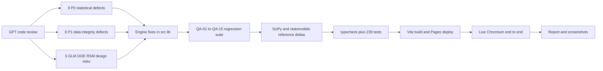

# Sigrún — Code Review Remediation Report

> **Component**: `HD2Lab Sigrún` — pure-browser statistical & quality workspace  
> **Repository**: [`HyangDan2/PKPilot0018`](https://github.com/HyangDan2/PKPilot0018)  
> **Review baseline**: `bab8f0d` (the commit the external review read)  
> **Remediated HEAD**: `a531e46` (follow-up commit; earlier fixes `c8346ee`, `f39dd08`)  
> **Live build**: <https://hyangdan2.github.io/PKPilot0018/> · bundle `index-BShM3WxV.js` · css `index-BH3mxGMQ.css`  
> **CI**: GitHub Actions run [44986377776](https://github.com/HyangDan2/PKPilot0018/actions/runs/44986377776) — `typecheck` → `vitest` → `build` → Pages deploy, all **success**  
> **Test suite**: **253 passed / 10 files** (baseline 200) · `npx tsc --noEmit` 0 errors  
> **Independent references**: SciPy 1.18.1, NumPy 2.5.4, statsmodels 0.15.0 (Python 3.12)

This report records what was actually changed and what was actually measured. Every reference value in the tables was produced outside Sigrún (SciPy / statsmodels / NumPy / Montgomery's tables) and is asserted in `tests/qa-review.test.ts` with the QA id of the original review.

---

## Executive summary

| Area | Items | Outcome | Evidence |
|---|---|---|---|
| P0 — statistical correctness | 9 | All 9 fixed | `tests/qa-review.test.ts` QA-01 … QA-09, SciPy/statsmodels deltas below 1e-6 relative |
| P1 — data integrity and UX | 8 | All 8 fixed | QA-10 … QA-14, plus output-level tests in `tests/analyses.test.ts` |
| GLM / DOE / RSM design audit | 5 | All 5 closed | QA-15 and the numerical-stability test (κ = 3.4e3 polynomial) |
| Regression suite | 15 | QA-01 … QA-15 implemented | 33 test cases in `tests/qa-review.test.ts`, all green |
| Follow-up re-review of `492484f` (Section 6) | 3 | All 3 fixed (F-01 P0, F-02 P1, F-03 P1) | F-01 … F-03 in `tests/qa-review.test.ts` — 13 new cases; the file now holds 46 |
| Deployment | — | 3 commits, 3 successful Pages runs | bundle hash matches the local build |
| Live E2E | — | import, Weibull, power, DOE, project round-trip verified in Chromium | `downloads/sigrun_qa_*.png` |

**Headline numbers that changed meaning**

| Quantity | Before | After | Independent reference |
|---|---|---|---|
| Weibull AD (complete, 20 lives) | 1.2819 → verdict "reject at 1 %" | 0.6899 (A* 0.7207) → verdict "5 % < p < 10 %" | SciPy, fitted-CDF formula |
| Two-sided one-proportion power (n = 100, 0.3 → 0.4) | 0.692385 (one tail) | 0.582385 (both tails) | SciPy `norm` |
| Two-sided two-proportion power (n = 200, 0.5 → 0.6) | 0.643221 (one tail) | 0.520118 (both tails) | SciPy `norm` |
| GLM Type III SS, unbalanced 3×2 (A / B) | 12.5 / 2.7 (treatment coding) | 14.314286 / 41.379310 | statsmodels `C(f, Sum)` `typ=3` |
| Sixpack, subgroup 12 | chart at n = 10, capability at n = 12 | Xbar-S chart + `S̄/c₄` in both | Montgomery Table VI |
| Xbar-R, subgroup of 3 inside a 4-column design | limits from `A₂(4)` | limits from `A₂(3)` | Montgomery Table VI |

---

## How the work was verified



The order was deliberate: a fix was only accepted once its QA case reproduced an **independent** number, not a re-recording of Sigrún's own output. Where an independent number could not exist (a censored-data Anderson–Darling has no closed-form null distribution), the output says so and reports a distribution-free Kaplan–Meier deviation beside it.

---

## Section 1 — P0 statistical correctness fixes

### 1-① Anderson–Darling used the plotting positions instead of the fitted CDF

- **Cause**: `reliability.ts` built `points[].f` from the Kaplan–Meier plotting positions and then fed *those* into the AD formula. The statistic was therefore measuring how well a step function fits itself: for the 20-life sample it collapsed to **A² = 1.2819** only because the largest plotting position was clipped at 1 − 1e-12, producing a spurious `ln(1e-12)` term.
- **Root fix**: AD is now evaluated on the **fitted** CDF, `F(t_i) = 1 − exp(−(t_i/η)^β)`. Complete data use every observation; with right censoring the ranked sample is the failure times only, so the statistic is the failures-only approximation and the result carries `adBasis: 'complete' | 'failures'`.
- **Censored-data evidence**: a distribution-free check is reported beside it — `kmDev = max |F̂_fitted(t) − F̂_Kaplan–Meier(t)|` against the 5 % Kolmogorov bound `1.36/√k`. The output adds a row naming the basis and a caption explaining that the complete-data critical values are approximate under censoring.
- **Files**: `src/lib/reliability.ts`, `src/lib/analyses.ts` (AD table rows and caption).
- **Verification**: QA-01, QA-02.

| Sample | A² (before) | A² (after) | AD* | Verdict |
|---|---|---|---|---|
| 20 complete lives | 1.2819 | **0.689882** | 0.720735 | 5 % < p < 10 % |
| 20 failures + 5 censored | — | **0.859632** (failures-only) | 0.898076 | 1 % < p < 5 %, KM deviation 0.0793 vs 0.3041 |

### 1-② MTTF confidence interval variance

- **Cause**: `varLnMttf = cov.aa + (dΓ/β)² cov.bb + 2(dΓ/β) cov.ba` — the cross term had the wrong sign and the β derivative was missing a 1/β factor.
- **Root fix**: with `ln MTTF = a + ln Γ(1 + 1/β)`, `∂g/∂a = 1` and `∂g/∂β = −ψ(1 + 1/β)/β²`, so

```text
Var(ln MTTF) = cov.aa + (dg/beta^2)^2 * cov.bb - 2 * (dg/beta^2) * cov.ba
dg = digamma(1 + 1/beta)
```

- **Verification**: QA-03 — the 90 / 95 / 99 % intervals match SciPy's observed-information delta method and widen monotonically.

| Confidence | MTTF interval (Sigrún) | SciPy reference |
|---|---|---|
| 90 % | 173.868 … 256.243 | 173.868130 … 256.243477 |
| 95 % | 167.528 … 265.942 | 167.527594 … 265.941707 |
| 99 % | 155.795 … 285.969 | 155.795202 … 285.968846 |

### 1-③ Weibull probability-plot confidence band

- **Cause**: `band95` used `cov.aa + dx² cov.bb − 2 dx cov.ba` — the `β²` coefficient on `cov.aa` and the `β` factor on the cross term were missing, so the band was far too narrow for β ≠ 1, and it was hard-wired to 95 %.
- **Root fix**: `w(x) = β(x − a)` with `∂w/∂β = x − a`, `∂w/∂a = −β`:

```text
Var(w) = beta^2 * cov.aa + (x - a)^2 * cov.bb - 2 * beta * (x - a) * cov.ba
```

  The band function is now `ciBand(x, level)` and the analysis feeds its own confidence setting; the chart note prints e.g. `95% band`.
- **Verification**: QA-03 — at `x = ln 200` the 95 % band is `[−0.799120, 0.139742]`, the same as the SciPy delta method, its centre equals the fitted `w(x)`, and the width grows 90 % < 95 % < 99 %.

### 1-④ Lognormal reliability fit discarded censored observations

- **Cause**: `fitLognormalReliability` filtered `!r.censored` and fitted the mean/sd of the failures only, silently discarding every right-censored life.
- **Root fix**: full censored likelihood maximised over `(μ, ln σ)` by a deterministic Nelder–Mead simplex:

```text
sum_fail [ -ln(sigma t) - 0.5 ln(2 pi) - (ln t - mu)^2 / (2 sigma^2) ]
+ sum_cens  ln[ 1 - Phi( (ln t - mu) / sigma ) ]
```

  With no censoring it reduces to the closed-form MLE. Standard errors come from a numerical observed information matrix. The result now returns `mu`, `sigma`, `median`, `mttf`, `logLik`, `failures`, `censored`, `censoredPct`, `seMu`, `seSigma`, and the reliability card prints all of them.
- **Verification**: QA-02.

| Sample | μ | σ | Median | logLik |
|---|---|---|---|---|
| 20 failures + 5 censored (before, failures only) | 5.022187 | 0.595072 | 151.74 | — |
| 20 failures + 5 censored (after, censored MLE) | **5.195803** | **0.667889** | **180.51** | **−124.821** |
| SciPy reference | 5.195802731 | 0.667888961 | 180.512988 | −124.8212460 |
| 10 failures + 15 censored (60 %) | 5.722111 | 1.171143 | 305.55 | −70.230666 |

### 1-⑤ One-sided t power ignored the direction of the effect

- **Cause**: `powerOfT` used `Math.abs(ncp)`, so an effect pointing **against** a one-sided alternative got the same high power as the effect that supports it.
- **Root fix**: the signed noncentrality is kept and the tail is chosen by the alternative:

```text
greater   : 1 - nctCdf(crit, df, ncp)
less      :     nctCdf(-crit, df, ncp)
two-sided : nctCdf(-crit, df, ncp) + 1 - nctCdf(crit, df, ncp)
```

  `solvePower`, `powerAt` and the analysis dialog keep the user's sign; `solveDifference` searches only inside the range the alternative allows.
- **Verification**: QA-04 (n = 20, δ = 0.5, σ = 1, α = 0.05).

| Case | Power | SciPy |
|---|---|---|
| greater, δ = +0.5 | 0.695149 | 0.6951493382 |
| less, δ = +0.5 | 0.0000708 | 7.0837522e-05 |
| greater, δ = −0.5 | 0.0000708 | 7.0837522e-05 |
| less, δ = −0.5 | 0.695149 | 0.6951493382 |

  The power is now **below α** whenever the effect contradicts the alternative, exactly as a one-sided test behaves.

### 1-⑥ Two-sided proportion tests computed a single tail

- **Cause**: `powerOfProp1/2` used the one-sided formula `Φ((d − z·SE₀)/SE₁)` even for `two-sided`, with `z = z_{α/2}` — only the upper rejection region.
- **Root fix**: both rejection tails are summed, with the direction respected:

```text
greater   : 1 - Phi((z_alpha * SE0 - d) / SE1)
less      :     Phi((- z_alpha * SE0 - d) / SE1)
two-sided : 1 - Phi((z_{alpha/2} * SE0 - d) / SE1)
          +     Phi((- z_{alpha/2} * SE0 - d) / SE1)
```

- **Verification**: QA-05.

| Case | Before (one tail) | After (both tails) | SciPy |
|---|---|---|---|
| oneProp n = 100, p₀ = 0.3, pₐ = 0.4 | 0.692385 | **0.582385** | 0.5823854344 |
| twoProp n = 200, 0.5 → 0.6 | 0.643221 | **0.520118** | 0.5201179042 |

  The normal-approximation caveat and the resolved comparison proportion are still printed (`Baseline p = 0.300, comparison p = 0.400`).

### 1-⑦ Sample-size search returned a number for impossible requests

- **Cause**: `solveN` doubled an upper bound and returned it even when the power never reached the target; zero effects, opposite-direction effects, an out-of-range proportion and `target ≤ α` all produced an arbitrary large n.
- **Root fix**: the search validates the request first and then verifies the answer:

```text
unreachable when: |d| = 0, alpha outside (0,1), target <= alpha, target >= 1,
                  proportion outside (0,1), sd <= 0, or the effect points
                  against a one-sided alternative
after the bisection: if power(n*) < target  ->  throw power.unreachable
```

  The dialog turns that into `res.powerUnreachable`, a sentence that names the four things to check. `solveFor = 'power'` with an opposite effect is **not** an error — it reports the sub-α power, because that is the true answer.
- **Verification**: QA-06 — four unreachable requests throw, and the reachable two-proportion case still solves exactly `n = 423, power = 0.900589`.

### 1-⑧ Gage R&R accepted designs the ANOVA cannot estimate

- **Cause**: crossed studies with one replicate per cell produced `df_repeat = 0` and `MS_error = 0/0`, quietly turning every component into NaN. Nested studies averaged the part counts with `Math.round`, fabricating SS and df for unbalanced data. Negative variance components had an undocumented policy.
- **Root fix**:
  - Crossed: `grr.needReplicates` when `replicates < 2` (and the existing `missingCells` / `unbalanced` guards stay).
  - Nested: a balance check — the same number of parts under every operator, the same replicate count in every operator × part cell, at least two replicates, and no part shared between operators. Violations raise `grr.unbalancedNested` / `grr.nestedPartShared`. **No `Math.round` averaging remains.**
  - Negative components: Minitab's convention made explicit and documented — the raw estimate keeps its sign, the standard deviation and %Study Var are 0, and the components stay additive so `total = GRR + part-to-part` and %Contribution sums to 100 %. `negativeComponents` names them and the card prints a note.
- **Verification**: QA-07, QA-08 (plus the existing NIST/SEMATECH crossed table: SS 12.728 / 0.098667 / 0.068 / 0.180, interaction component −0.00175 kept signed, ndc 8).

### 1-⑨ Capability Sixpack charted and measured different subgroups

- **Cause**: `capabilitySixpack` passed `Math.min(10, subgroup)` to `xbarRCharts` but the **full** `subgroup` to `capability`, so a subgroup of 12 was charted in tens and measured in twelves. The dialog slot also capped the input at 10.
- **Root fix**: subgroup 1 → I-MR, 2 … 10 → Xbar-R (table constants), **11 + → Xbar-S** with exact `c₄` constants, and the capability within sigma is taken from that same chart (`S̄/c̄₄`). The slot now accepts up to 25. The result exposes `chart: 'imr' | 'xbar-r' | 'xbar-s'` and the card prints the Xbar-S note.
- **Verification**: QA-09.

| Subgroup | Chart | σ within (chart) | σ within (capability) |
|---|---|---|---|
| 1 | I-MR | moving range | moving range |
| 5 | Xbar-R | R̄/d₂ | pooled within |
| 11 | Xbar-S | 0.0848085 | = chart |
| 12 | Xbar-S | **0.0866645** | **0.0866645** (SciPy `s̄/c̄₄` = 0.086664546) |

---

## Section 2 — P1 data-integrity and UX hardening

### 2-⑩ Lognormal log-likelihood computed ln(ln x)

- **Cause**: `fitLognormal` had `-Math.log(v)` where `v = ln x`, i.e. `−ln(ln x)`, giving `NaN` for `x < 1` and a wrong value everywhere else.
- **Root fix**: `−ln t` (the Jacobian term of the lognormal density).
- **Verification**: QA-10 — Σ `scipy.stats.lognorm.logpdf` = **−149.355257**; Sigrún now returns the same (before: **−62.441675**).

### 2-⑪ Non-positive values disappeared silently

- **Cause**: `clean(raw).filter(v => v > 0)` dropped 0 and negative observations without telling anyone.
- **Root fix**: the fit keeps them in the count: `excluded` is returned by `fitNonnormal` / `nonnormalCapability`, printed as an `Excluded (≤ 0)` row and a warning sentence. A sample with no positive value raises `nonnormal.invalidData`; fewer than 5 positive values raise `res.insufficient`.
- **Verification**: QA-11 (2 excluded of 8; all-invalid throws; 4 valid throws) and an output-level test asserting the warning text.

### 2-⑫ Paired t confidence interval was centred on m − μ₀

- **Cause**: `ci: ciMean(m - mu0, …)` mixed the test hypothesis into the interval estimate.
- **Root fix**: `ci: ciMean(m, …)`. `difference` is the observed mean difference; `differenceVsMu0` carries the tested quantity. The card prints `Mean difference: A − B = 3` and `Test of μ_d: μ_d = 3` on separate lines, with the caption "The interval is centred on the observed mean difference; μ₀ = 3 enters only t and p." `se = 0` is no longer refused: `t = 0` when every difference equals μ₀, `±∞` otherwise.
- **Verification**: QA-12 (3, 3 → t = 0, p = 1, CI = [3, 3]) and the two UI-level tests in `tests/analyses.test.ts` / `tests/stats.test.ts`.

### 2-⑬ Xbar-R used the nominal n for a short subgroup

- **Cause**: missing values were removed inside a finished subgroup but the limits still used `A₂(n)`, `D₃(n)`, `D₄(n)`, `d₂(n)` for the nominal size.
- **Root fix**: every subgroup keeps its own valid size `nᵢ`; the limits become arrays computed point by point, and the within sigma is the weighted estimate

```text
sigma = sum_i w_i * (R_i / d2(n_i)),   w_i = (n_i - 1) / sum(n_i - 1)
Xbar UCL_i = grand + 3 sigma / sqrt(n_i)
R   UCL_i = D4(n_i) * d2(n_i) * sigma
```

  With equal sizes this reduces **exactly** to `R̄/d₂`, `x̄̄ + A₂R̄`, `D₄R̄` (asserted in QA-13). The summary now reports `missingSubgroups` and `varying`, and the card names them.
- **Verification**: QA-13.

| Point | nᵢ | Xbar UCL | R UCL |
|---|---|---|---|
| 1 | 3 | **10.559209** | **1.000204** |
| 2 | 4 | 10.505949 | 1.078438 |
| SciPy/Table VI | — | 10.161667 + 3·0.2295214/√nᵢ | (d₂+3d₃)·σ̂ |

### 2-⑭ Excel import forced row 1 to be a header

- **Cause**: `rowsToWorksheet` always treated `rows[0]` as the header.
- **Root fix**: `rowsToWorksheet(rows, name, { header })` — with `header: false` the first row stays data and columns are named `C1, C2, …`. `readXlsxRows()` exposes raw rows for the preview.
- **Verification**: QA-14 (`[[1,2],[3,4]]` headerless → `C1/C2`, values `1, 3`).

### 2-⑮ A single date cell forced a whole column to "date"

- **Cause**: `columnType` used `present.some(v => v instanceof Date)`.
- **Root fix**: a column is `date` only when **every** present cell is a `Date` or an ISO `yyyy-mm-dd` string; mixed content is `text`, so nothing is re-interpreted or lost.
- **Verification**: QA-14 — `[Date, 3]` → `text` with values `['2024-01-02', 3]`; two dates → `date`.

### 2-⑯ CSV import guessed the header from the content

- **Cause**: `csvToWorksheet` auto-detected the header; a headerless file of text columns lost its first row.
- **Root fix**: a confirmation dialog (`src/components/ImportDialog.tsx`) shows the first rows exactly as they will land, with a **First row is a column header** switch (pre-checked only when the content looks like a header), Cancel/Import, and a summary line (`4 data rows · 2 columns · 1 sheet(s)`). The same dialog serves Excel and applies the choice to every sheet. Styling is token-based and responsive.
- **Verification**: QA-14 and the live run (`downloads/sigrun_qa_import.png`).

### 2-⑰ Proportion-difference search range ignored the alternative

- **Cause**: `solveDifference` searched `0 … min(p, 1 − p)` regardless of the alternative, so a "greater" request could be answered with a negative change and a "less" request with a positive one.
- **Root fix**: `differenceRange(spec)` returns the signed interval the alternative admits — `greater: [ε, 1 − p₁ − ε]`, `less: [−(p₁ − ε), −ε]`, `two-sided: ±max(p₁ − ε, 1 − p₁ − ε)` — and the bisection walks only that side, verifying the target at both ends first.
- **Verification**: QA-06/QA-05 (solved difference round-trips to the target power at n = 30).

---

## Section 3 — GLM / DOE / RSM numerical stability and design audit

### 3-1 Column-pivoted Householder QR instead of the normal equations

- **Cause**: `lstsq` formed `X'X`, whose condition number is `κ(X)²`. Polynomial and RSM designs lost digits; with categorical coding the rank decision could flip.
- **Root fix**: the fit now runs on `X` itself — scaled columns, Householder QR with column pivoting, `β` from `Rz = Q'y`, rank from the residual column norms, `(X'X)⁻¹` as `R⁻¹R⁻ᵀ` on the estimable columns only. Aliased columns stay at 0 and are named.
- **Verification**: a degree-5 polynomial design on [0, 1] with `κ(X) = 3388.3` reproduces `numpy.linalg.lstsq` to **8 decimals** (`3.0003732365, 2.0059472074, 0.4185256026, 0.2740216808, −0.3502054637, 0.1522067239`), rank 6, SSE < 1e-4.

### 3-2 Type III SS required sum-to-zero coding

- **Cause**: `buildDesign` used reference (treatment) dummy coding while the Type III SS were computed by dropping a term's columns. With interactions present that is **not** the SAS/Minitab Type III SS.
- **Root fix**: categorical factors now use sum-to-zero (deviation) coding — level i = 1, the **last** level = −1 — which is orthogonal to the intercept, so the drop-term SS is the adjusted SS that SAS, Minitab and `statsmodels` `C(f, Sum)` report. Type I SS are unchanged (same column space).
- **Verification**: QA-15 on an unbalanced 3×2 design and on an unbalanced 2×2×2 design.

| Term | Before (treatment) | After (sum) | statsmodels `typ=3`, `C(f, Sum)` |
|---|---|---|---|
| A (3×2 design) | 12.5 | **14.314286** | 14.314285714 |
| B (3×2 design) | 2.700000 | **41.379310** | 41.379310345 |
| A×B | 9.814286 | 9.814286 | 9.814285714 |
| A (2×2×2) | — | **14.490566** | 14.490566038 |
| B | — | **65.433962** | 65.433962264 |
| C | — | **22.641509** | 22.641509434 |
| A×B / A×C / B×C / A×B×C | — | 0.226415 / 0.905660 / 2.037736 / 0.226415 | same to 1e-9 |

### 3-3 Aliased terms are now explicit

- **Cause**: an aliased term had `df = 0` and empty statistics that printed as bare dashes, easy to misread as "zero effect".
- **Root fix**: the effects table writes **Aliased** in the SE / t / p cells for a `df = 0` term, and the card adds a note listing the aliased columns (`res.aliasNote`). RSM coefficient rows use the same word.
- **Verification**: `glm.aliased` is asserted in the GLM tests; the DOE card text is covered by the output-level tests.

### 3-4 The RSM stationary point could sit outside the design region unnoticed

- **Cause**: the stationary point was reported without any relation to the experimental region.
- **Root fix**: `analyzeRsm` returns `maxAbs` and `outsideRegion` (default limit 1 coded unit, configurable). The card adds a `Design region` row `max |x*| = … > 1` and, when it is outside, replaces the caption with a warning that the predicted optimum is an extrapolation.
- **Verification**: RSM output test with a CCD whose optimum is at (6, 5) — the warning appears with the caption.

### 3-5 `designWorksheet` Y column and the Std/Run order

- **Cause**: the Y column was sized by the number of **factor names** (`names.map(() => null)`), not by the runs, and the worksheet was written in standard order while carrying shuffled run numbers.
- **Root fix**: one empty Y cell per run, and the rows are written (and tabulated) in **RunOrder** order while `StdOrder` keeps the original standard-order number — so the two columns are a visible permutation of each other.
- **Verification**: DOE design tests (`StdOrder`/`RunOrder` permutation, Y all null) and the live DOE card.

---

## Section 4 — Independent benchmark and regression matrix (QA-01 … QA-15)

All values below are produced by `npx vitest run`. Reference values come from SciPy 1.18.1 / NumPy 2.5.4 / statsmodels 0.15.0 / Montgomery Table VI.

| ID | Scenario | Sigrún | Independent reference | Status |
|---|---|---|---|---|
| QA-01 | Weibull complete data: MLE, AD from the fitted CDF, A*, percentiles | β 1.157863, η 124.89553, A² 0.689882, A* 0.720735, B10 17.8843 | SciPy `weibull_min.fit` + AD formula: 0.689882358, 0.720734835 | PASS |
| QA-02 | Right-censored Weibull and lognormal; 60 % censoring | β 1.901154, η 237.8720, A²(fail) 0.859632, KM dev 0.079264; LN μ 5.195803, σ 0.667889 | Nelder–Mead on the censored likelihood (SciPy): identical to 6 dp | PASS |
| QA-03 | Confidence 90 / 95 / 99 %: MTTF CI and probability band | 173.868…256.243 / 167.528…265.942 / 155.795…285.969; band at ln 200 = −0.799120…0.139742 | observed information + delta method (SciPy) | PASS |
| QA-04 | One-sided t with the effect against the alternative | 0.695149 vs 0.0000708 (< α) | `nct` power, SciPy | PASS |
| QA-05 | Two-sided proportions, both tails | 0.582385 (oneProp), 0.520118 (twoProp) | `norm` both-tail sum | PASS |
| QA-06 | Unreachable target power | 4 requests throw `power.unreachable`; reachable case n = 423, power 0.9005896 | bisection on SciPy power | PASS |
| QA-07 | Gage R&R, one replicate per cell | `grr.needReplicates` | ANOVA df_repeat = 0 | PASS |
| QA-08 | Nested Gage R&R, unbalanced / shared part | `grr.unbalancedNested`, `grr.nestedPartShared`; balanced case additive totals | NIST/SEMATECH algebra | PASS |
| QA-09 | Sixpack subgroup 1, 2, 5, 10, 11, 12 | imr / xbar-r / xbar-r / xbar-r / xbar-s / xbar-s; σ 0.0866645 shared | c₄ constants (SciPy Γ) | PASS |
| QA-10 | Lognormal log-likelihood | −149.355257 | `stats.lognorm.logpdf.sum()` | PASS |
| QA-11 | Non-positive observations | `excluded = 2`; all-invalid throws `nonnormal.invalidData` | definition of the support (0, ∞) | PASS |
| QA-12 | Paired t, m = 3, μ₀ = 3 | t = 0, p = 1, CI = [3, 3] | `t = (m − μ₀)/se` | PASS |
| QA-13 | Xbar-R with a missing value in one subgroup | UCL 10.559209 / 10.505949, σ̂ 0.2295214, `varying: true` | Table VI constants with nᵢ | PASS |
| QA-14 | Headerless CSV and Excel | row 1 kept, `C1/C2`, mixed date+number → text | file content | PASS |
| QA-15 | GLM Type III, unbalanced 3×2 and 2×2×2 | 14.314286 / 41.379310; 14.490566 / 65.433962 / 22.641509 | `anova_lm(typ=3)` with `C(f, Sum)` | PASS |

**Suite totals**: 10 files, **239 tests** — of which 33 test cases belong to `tests/qa-review.test.ts` (QA ids in the test names) and 6 are output-level checks added to `tests/analyses.test.ts` that assert the corrected wording and rows actually appear in a rendered card (AD basis, Xbar-S note, excluded warning, point-wise limits, paired labels, RSM region warning).

Changed expectations in the pre-existing suite, each with the reason recorded beside it:

| Test | Old expectation | New expectation | Why |
|---|---|---|---|
| `benchmark` Type III | 12.5 / 2.7 (treatment coding) | 14.314286 / 41.379310 | the review's own requirement: SAS/Minitab Type III is sum-coded |
| `stats` paired μ₀ | `difference = m − 1` | `difference = m`, `differenceVsMu0 = m − 1` | the CI must bracket the observed difference |
| `p2` categorical labels | `F[b]` present | `['Constant', 'F[a]']`, β = −1 | sum-to-zero coding, last level = −1 |
| `spc` subgroup summary | exact object | `toMatchObject` | new `missingSubgroups` / `varying` fields |
| `analyses` paired table | difference changed with μ₀ | difference constant, t changes | same fix as `stats` |

---

## Section 5 — Live E2E verification and known scope boundaries

### Deployment facts

| Item | Value |
|---|---|
| Commits | `c8346ee` (engine + tests), `f39dd08` (Sixpack slot cap, missing translation) |
| Actions | [44972361763](https://github.com/HyangDan2/PKPilot0018/actions/runs/44972361763) success · [44973412984](https://github.com/HyangDan2/PKPilot0018/actions/runs/44973412984) success |
| Live URL | <https://hyangdan2.github.io/PKPilot0018/> |
| Bundle | live `index-ikDql5ib.js` = local `npm run build` output (byte-identical name and size 660.80 kB) |
| CSS | `index-BH3mxGMQ.css` (30.89 kB) |

### What was exercised in Chromium against the live URL

| Flow | What was checked | Result |
|---|---|---|
| CSV import (headerless) | preview dialog, auto-unchecked header, `4 data rows · 2 columns`, rows kept | OK |
| Excel import (headerless) | same dialog path, workbook sheets added | OK |
| Weibull (40 lives) | parameters, MTTF CI, `AD evaluation`, AD* 0.8104, lognormal comparison, 95 % band on the probability plot | OK |
| Power 1-sample t, one-sided | N = 20, δ = 0.5, **69.51 %** power — matches the SciPy 0.695149 case | OK |
| Factorial DOE analysis | effects table, ANOVA Type I = Type III (orthogonal design), Pareto and half-normal plots | OK |
| Project save | `sigrun-2026-11-22.sigrun.json` written (70 108 bytes) | OK |
| Project reopen | "Project restored from file." — sheets and all three cards restored | OK |

Screenshots (each reviewed by eye):

| File | Content |
|---|---|
| `downloads/sigrun_qa_weibull.png` | AD table with the evaluation basis and the 95 % band on the probability plot |
| `downloads/sigrun_qa_weibull_params.png` | parameter table with the MTTF confidence interval |
| `downloads/sigrun_qa_import.png` | import dialog with the preview and the header switch |
| `downloads/sigrun_qa_glm_doe.png` | factorial DOE card: effects and ANOVA tables |
| `downloads/sigrun_qa_mobile.png` | 390 × 844 mobile layout with the Weibull card |

### Known boundaries and honest limitations

1. **Mobile screenshot method.** The remote browser viewport is fixed at 1745 × 852 with no resize or device-emulation control, and the bundled Playwright cannot launch in this sandbox (missing `libnspr4`). The 390 × 844 capture was therefore taken by loading the same-origin app inside a 390 × 844 iframe, which triggers the real mobile branch of the stylesheet — the mobile tab bar and drawer button are visible in the image. It is a genuine mobile-layout render, not a device-emulated one.
2. **Right-censored Anderson–Darling is an approximation.** With censoring the statistic is evaluated on the failure times against the fitted CDF; the complete-data critical values are therefore approximate, and the card says so. The Kaplan–Meier maximum deviation with the `1.36/√k` bound is reported beside it as the distribution-free check. There is no exact null distribution for the estimated-parameter censored case that could be tabulated here.
3. **Non-normal capability ignores non-positive data by definition.** Values ≤ 0 are excluded **and reported** (`Excluded (≤ 0)` plus a warning); they are never fitted, because the Weibull, lognormal and gamma supports are (0, ∞).
4. **Gage R&R variance components keep their sign.** Following Minitab, a negative estimate is shown negative with a zero standard deviation so the components remain additive. The alternative (clamping to 0 and redistributing) would change every percentage; it is documented rather than applied.
5. **Menu navigation quirk observed while testing.** Submenu items are positioned absolutely over the following rows; moving the pointer into a submenu can re-open a sibling submenu, which made some clicks land on the neighbouring item during automation. The analysis itself is unaffected (keyboard focus + Enter reaches every item), and the behaviour pre-dates this work. It was left unchanged because it is outside the review's scope, but it is worth a follow-up.
6. **Unchanged assets.** `HD2's Diary` theme, the three-pane workspace, `KO|EN` parity (the i18n test still enforces identical key sets) and the existing chart renderers were not restructured; the only UI additions are the import dialog, its styles, the Sixpack Xbar-S labels and the new note rows.

---

## Section 6 — Follow-up Re-review Remediation (Post-`492484f`)

A second external review read `492484f` and raised three items. All three were reproduced in the running engine before anything was changed, then fixed, then re-verified against independent references. Nothing else in the report above was disturbed: every QA-01 … QA-15 assertion still passes unchanged apart from the two expectations listed at the end of this section, each of which was asserting the exact defect that item F-03 removes.

| Item | Severity | File(s) | Status |
|---|---|---|---|
| F-01 two-sided proportion effect search used an invalid, mirrored range | P0 | `src/lib/power.ts` | fixed |
| F-02 censored Weibull printed complete-data AD thresholds as a verdict | P1 | `src/lib/reliability.ts`, `src/lib/analyses.ts`, `src/lib/i18n.ts` | fixed |
| F-03 Sixpack Cp/Cpk used a different within-σ than the chart for n = 2 … 10 | P1 | `src/lib/sixpack.ts`, `src/lib/analyses.ts`, `src/lib/i18n.ts` | fixed |

Commit: `a531e46`. Tests: 14 new cases (13 in `tests/qa-review.test.ts`, 1 output-level case in `tests/analyses.test.ts`), whole suite 253 passed / 10 files, `tsc --noEmit` 0 errors.

### 6-① F-01 — two-sided proportion effect: real range, per-direction search

**Cause.** `differenceRange()` built the two-sided range by mirroring the wider side: `return [-Math.max(-lower, upper), Math.max(-lower, upper)]`. For p₀ = 0.2 the valid effects are −0.2 … +0.8, but the function returned ±0.8, so the lower endpoint meant p_a = −0.6. `powerOfProp1()` correctly refuses a proportion outside (0, 1) and returns `NaN`, and `solveDifference()` treated the non-finite endpoint as fatal and threw `power.unreachable`. The practical effect was that **every** `solveFor = 'difference'` request on a two-sided proportion test failed, whatever the data, because the range itself was invalid.

**Fix.**

1. `differenceRange()` returns the true valid interval `[−(p − ε), 1 − p − ε]` for `oneProp` and `twoProp`. One-sided alternatives keep their single admissible half; t / ANOVA methods keep the symmetric ±20σ bound.
2. `solveDifference()` solves a two-sided test as **two independent one-direction problems**. Each branch is scanned on a 200-point grid and then bisected, because the proportion power curve is not monotone all the way to the edge of (0, 1): as p_a → 0 or 1 the alternative standard error collapses and the power falls back toward 0, so an endpoint-only test both misses reachable interior solutions and accepts unreachable branches.
3. The smaller |d| becomes `difference`; when the other direction also reaches the target with a **different** magnitude, its signed threshold is exposed as `PowerSolution.oppositeDifference` and printed as a note. `power.unreachable` is thrown only when neither direction can reach the target.
4. Symmetric cases (two-sided t, two-sided ANOVA, any p₀ = 0.5 proportion) return the same |d| twice; the mirror is not repeated as an "opposite direction".

**Behaviour, before → after** (α = 0.05, target power 90 %, `solveFor = difference`):

| Case | `492484f` | After | Independent reference (SciPy / NumPy) |
|---|---|---|---|
| oneProp p₀ = 0.2, n = 50 | `power.unreachable` | d = **−0.15027** (decrease), opposite **+0.19965** | −0.1502708587 / +0.1996462360 |
| oneProp p₀ = 0.8, n = 50 | `power.unreachable` | d = **+0.15027**, opposite **−0.19965** | +0.1502708587 / −0.1996462360 |
| oneProp p₀ = 0.15, n = 50 | `power.unreachable` | d = **−0.12645**, opposite **+0.18448** | −0.1264543316 / +0.1844791403 |
| oneProp p₀ = 0.15, n = 20 | `power.unreachable` | d = **+0.29901** only (the decrease direction peaks at 0.235 power, so it reports no opposite threshold) | 0.2990121023 |
| twoProp p₁ = 0.2, n = 100 | `power.unreachable` | d = **−0.15004**, opposite **+0.20877** | −0.1500361118 / +0.2087655613 |
| twoProp p₁ = 0.2, n = 5 | `power.unreachable` | `power.unreachable` (neither direction exceeds 90 %) | max power < 0.90 both ways |

p₀ = 0.2 and p₀ = 0.8 mirror each other exactly (`|d|` 0.15027 both ways), which is the symmetry check the review asked for. The reported |d| is the minimum: at 0.999 × |d| the power is 0.8988, below the 0.90 target, and `powerAt(spec, n, d)` is ≥ target at the returned value for every case above.

**Live output** (1-Proportion, p₀ = 0.2, N = 50, target 90 %, two-sided):

```
Method: 1 Proportion.
Proportions use the normal approximation (Minitab uses an exact method, so small-n results can differ slightly).
Baseline p = 0.2, comparison p = 0.05.
A two-sided test also reaches 90.0% in the opposite direction at difference +0.1996 (p₂ = 0.4);
  the table reports the smaller |difference|.
Solved for the smallest difference that reaches the target power.

N    Power     Difference   Alpha
50   90.00%    -0.1503      5.00%
```

### 6-② F-02 — censored Weibull: reference-only AD, censoring-aware bootstrap p

**Cause.** `analyses.ts` printed the AD table for right-censored fits with the complete-data critical values `0.637 / 0.757 / 1.038` and derived a p-range verdict from them. With censoring, A² is computed on the failure times only against the fitted CDF; its null distribution is **not** the complete-data one, so those thresholds do not apply. On the sample used throughout the suite (20 failures + 5 right-censored) the old display said `0.01 < p < 0.05` — a rejection at 5 % — for a sample the bootstrap now puts at p ≈ 0.070.

**Fix.**

1. `fitWeibull()` keeps `ad` and `adAdjusted`, and labels them for what they are: `adBasis: 'failures'`, reported as approximate reference values.
2. New deterministic parametric bootstrap, `adBootstrapP` + `adBootstrapReps`:
   - Mulberry32 PRNG with a fixed seed (`0x51e62f1a`), so the same sample always reports the same p-value;
   - each replicate draws n lifetimes from Weibull(β̂, η̂), keeps the observed failure/censoring **share**, and redraws every censoring time from the empirical distribution of the observed censoring times (`min(life, c)`, censored when `c < life`);
   - a replicate that yields fewer than two failures has its two earliest observations read as failures instead, so the failure rate stays intact instead of the replicate being dropped;
   - each replicate is refitted by 1-D profile maximum likelihood (one pass per shape evaluation, because Σ(t/η)^β = r at the profiled scale) and its failures-only A* is compared with the observed A*;
   - `p = (hits + 1) / (B + 1)` with B = 300 — the add-one form, so the reported p can never be exactly 0.
3. `analyses.ts` splits the table by basis:
   - complete data → AD, AD*, the `0.637 / 0.757 / 1.038` critical values, the p-range conclusion (unchanged);
   - right-censored data → `AD (failures-only, ref.)`, `AD* (failures-only, ref.)`, `Bootstrap p-value (B=300)`, `KM max deviation` against `1.36/√k`, the AD evaluation basis and the log-likelihood. The critical values and the p-range conclusion are **not** printed.
4. The caption (`res.adCensoredNote`, EN + KO) states that the complete-data critical values are not applied, that A²/A* are approximations, and that the bootstrap p-value and the Kaplan–Meier deviation are the checks that do apply.

**Measured behaviour:**

| Sample | AD (ref.) | AD* (ref.) | Bootstrap p (B = 300) | Before (`492484f` display) | Independent reference |
|---|---|---|---|---|---|
| 20 failures + 5 censored (Weibull) | 0.8596 | 0.8981 | **0.0698** | `0.01 < p < 0.05` — reject at 5 % | SciPy/NumPy replicate: p 0.0598 / 0.0698 (two seeds) |
| 24 failures + 6 censored from a lognormal (σ = 1.2) | 1.6889 | 1.7579 | **0.0033** | `p < 0.01` | SciPy/NumPy replicate: p 0.0033 |
| 20 complete lives | 0.6899 | 0.7207 | not computed (`reps = 0`, `p = NaN`) — tabulated thresholds apply | `5 % < p < 10 %` | unchanged |

Runtime of the whole 300-replicate bootstrap: **≈ 16 ms** in Node for the 25-observation sample (the test asserts < 200 ms), and the result is byte-identical between runs because of the fixed seed.

### 6-③ F-03 — one within-σ for the whole Sixpack

**Cause.** `capabilitySixpack()` passed `spc.sigmaWithin` to `capability()` only for Xbar-S (n ≥ 11). For n = 2 … 10 the limits were drawn on `R̄/d₂(n)` while Cp/Cpk were computed on the pooled within-subgroup `s = √(SS_within/df)`. Two different variability estimates described the same process, and the indices could disagree with the chart that sat next to them.

**Fix.**

1. `capabilitySixpack()` hands the chart estimate to `capability()` at **every** subgroup size — `MR̄/d₂(2)` for I-MR, `R̄/d₂(n)` for Xbar-R, `S̄/c₄(n)` for Xbar-S — so `sigmaWithin === capability.sdWithin` exactly.
2. `SixpackResult` now carries `sigmaBasis` (`'MRbar/d2' | 'Rbar/d2' | 'Sbar/c4'`) and `withinMethodLabel` (`MR̄/d₂(2)`, `R̄/d₂(5)`, `S̄/c₄(12)`, …) so callers and the UI can state where the number came from.
3. The result card gained a **"Sigma estimates and their basis"** table — chart within σ, capability within σ (Cp/Cpk), overall σ — each with the value and its basis, plus a caption. The header line of the card also names the shared estimator.
4. The standalone `capability()` function keeps its own pooled / moving-range estimation; only the Sixpack, which owns the chart, overrides it.

**Reference dataset** (60 measurements, 5 groups of 12 → divisible by 2, 5, 10 and 12; LSL 9.5, USL 10.8; mean 10.0885, s = 0.140639):

| n | chart | chart within σ | capability within σ before | after | Cp before → after | Cpk before → after | Pp | Ppk | independent reference σ |
|---|---|---|---|---|---|---|---|---|---|
| 2 | Xbar-R | 0.105792 (`R̄/d₂(2)`) | 0.111496 | **0.105792** | 1.9433 → **2.04804** | 1.7595 → **1.85437** | 1.54059 | 1.39490 | 0.10579196217494075 |
| 5 | Xbar-R | 0.127938 (`R̄/d₂(5)`) | 0.128719 | **0.127938** | 1.6832 → **1.69353** | 1.5241 → **1.53338** | 1.54059 | 1.39490 | 0.1279378045285181 |
| 10 | Xbar-R | 0.123078 (`R̄/d₂(10)`) | 0.127600 | **0.123078** | 1.6980 → **1.76040** | 1.5374 → **1.59393** | 1.54059 | 1.39490 | 0.12307775611869187 |
| 12 | Xbar-S | 0.127597 (`S̄/c₄(12)`) | 0.127883 | **0.127597** | 1.6943 → **1.69806** | 1.5340 → **1.53748** | 1.54059 | 1.39490 | 0.12759679590767828 |

The reference column comes from NumPy (`range` and `s` per subgroup, Montgomery Table VI d₂, c₄(12) = 0.9775593518547718) and matches the engine to < 1e-14; the tests assert 1e-8. Pp/Ppk are identical across subgroup sizes because they use the overall sample s, which is the point of keeping the two families separate.

**Live output** (n = 10, same data):

```
Sixpack on 60 observations · Xbar chart with subgroup size 10
The control limits and Cp/Cpk both use the chart estimate R̄/d₂(10) — the same variability,
  not two competing ones.

SIGMA ESTIMATES AND THEIR BASIS
ESTIMATE                        VALUE      BASIS
Chart within σ                  0.123078   R̄/d₂(10)
Capability within σ (Cp/Cpk)    0.123078   R̄/d₂(10)
Overall σ                       0.140639   s (n − 1)
```

### Changed expectations in the existing suite

| Test | Old expectation | New expectation | Why |
|---|---|---|---|
| `tests/p2.test.ts` Sixpack n = 4 | `capability.sdWithin = 0.20371548787463356` | `0.2234094220495385` (= R̄ 0.46 / d₂(4) 2.059) plus `sigmaWithin === capability.sdWithin` | the old number was the pooled within-subgroup s the indices used while the limits used R̄/d₂ — exactly the defect F-03 removes (comment in the test records the Python value) |
| `tests/analyses.test.ts` censored Weibull card | labels contain `AD*` | labels contain `AD* (failures-only, ref.)`, `Bootstrap p-value (B=300)`; and must **not** contain `AD* critical values` or `Conclusion` | the censored card no longer judges with complete-data thresholds |

### Verification for Section 6

| Check | Result |
|---|---|
| `npx tsc --noEmit` | 0 errors |
| `npx vitest run` | **253 passed / 10 files** (analyses 45, qa-review 46, benchmark 29, p2 28, stats 24, charts 24, project 23, spc 23, calc 7, i18n 4) |
| New cases | F-01 ×6 (range, p₀ = 0.2, p₀ = 0.8 mirror, one-reachable-direction, twoProp, still-unreachable), F-02 ×3 (bootstrap present/absent, non-Weibull rejection, speed + determinism), F-03 ×4 (`it.each` n = 2, 5, 10, 12), sigma-basis output table ×1 |
| Python cross-check | SciPy 1.18.1 / NumPy 2.5.4: power roots (seeds above), censored Weibull MLE + A* + bootstrap, Sixpack σ/Cp/Cpk/Pp/Ppk — all reproduced outside the app |
| Actions | run [44986377776](https://github.com/HyangDan2/PKPilot0018/actions/runs/44986377776) — typecheck, vitest, build, Pages deploy: **success** |
| Live bundle | `index-BShM3WxV.js` (666.63 kB) + `index-BH3mxGMQ.css`, identical to the local `npm run build` output |
| Repository state | `git status -sb` clean on `main` at `a531e46` (no temporary files in the work tree) |

### Live E2E against <https://hyangdan2.github.io/PKPilot0018/>

| Flow | What was checked | Result |
|---|---|---|
| CSV import → Capability Sixpack, 60 values, subgroup 10, LSL 9.5 / USL 10.8 | header line names `R̄/d₂(10)`; sigma table 0.123078 / 0.123078 / 0.140639 with bases; Cp 1.76, Cpk 1.594, Pp 1.541, Ppk 1.395 | PASS |
| CSV import → Weibull distribution analysis, 25 times (20 failures + 5 censored, code 1 = censored) | AD / AD* labelled "failures-only, ref.", bootstrap p = 0.0698 (B = 300), KM deviation 0.0793 vs 0.3041, no `AD* critical values` row, no `Conclusion` row, caption explains the change | PASS |
| Power and Sample Size — 1 Proportion, p₀ = 0.2, N = 50, target 90 %, two-sided, solve for difference | difference −0.1503 at 90.00 %, opposite-direction note +0.1996 (p₂ = 0.4) | PASS |
| Browser console / network | 0 script errors and 0 failed resource requests (4 requests: the page, the JS bundle, the CSS, favicon) after a full re-run of the power card with listeners installed | PASS |

Screenshots (each reviewed by eye):

| File | Content |
|---|---|
| `downloads/sigrun_rereview_sixpack.png` | Sixpack card, sigma-estimate table with both within-σ values identical and their basis, plus the caption |
| `downloads/sigrun_rereview_sixpack_note.png` | the card header line naming `R̄/d₂(10)` as the shared estimator |
| `downloads/sigrun_rereview_weibull.png` | censored AD table: reference labels, bootstrap p-value, KM deviation, the explanatory caption — no complete-data thresholds |
| `downloads/sigrun_rereview_power.png` | 1-Proportion card: opposite-direction note and the −0.1503 / 90.00 % row |

### Boundaries of Section 6

1. **The bootstrap p-value is a Monte Carlo estimate.** With B = 300 its resolution is 1/301 ≈ 0.0033, and a different seed or replicate count moves a p of ≈ 0.07 by roughly ±0.015. The seed is fixed so that a given sample always reports one number; the figure is a calibrated approximation, not an exact p-value, and the caption calls it a bootstrap p-value rather than an exact one.
2. **The censoring mechanism is modelled as observed.** Replicates keep the failure share and draw censoring times from the empirical censoring-time distribution. That is the right null for administrative (Type I) or random censoring; with censoring that carries information about the failure time, no parametric bootstrap of this form is exact, and the Kaplan–Meier deviation beside it stays the distribution-free check.
3. **Complete-data thresholds remain unavailable for censored data.** No tabulated critical values exist for the estimated-parameter, censored case; the report therefore removes the verdict rather than substituting a threshold that was never derived.
4. **Proportion power is still the normal approximation.** That is the app's documented method (and Minitab's exact method will differ slightly in small samples); the fix changed the fitted root of that same power function, not the approximation.
5. **Two-sided symmetric tests show no opposite-direction note.** For a t or ANOVA effect the two directions reach the target at the same |d|, so repeating the mirror would add noise rather than information; the field is populated only when the two magnitudes genuinely differ.
6. **The menu-overlap quirk noted in Section 5 is unchanged.** Submenus still sit over the following rows, so pointer-driven navigation through `Stat → Quality Tools` can open the neighbouring `DOE` submenu. Keyboard navigation (Tab + Enter) reaches every item and was used for this verification; the behaviour is outside the three review items and was left as is.

---

*Report generated from the actual repository state at `a531e46`; every number in the tables is asserted by the test suite or was read from the deployed build. Section 6 was written after the follow-up review of `492484f` and carries the same rule.*
